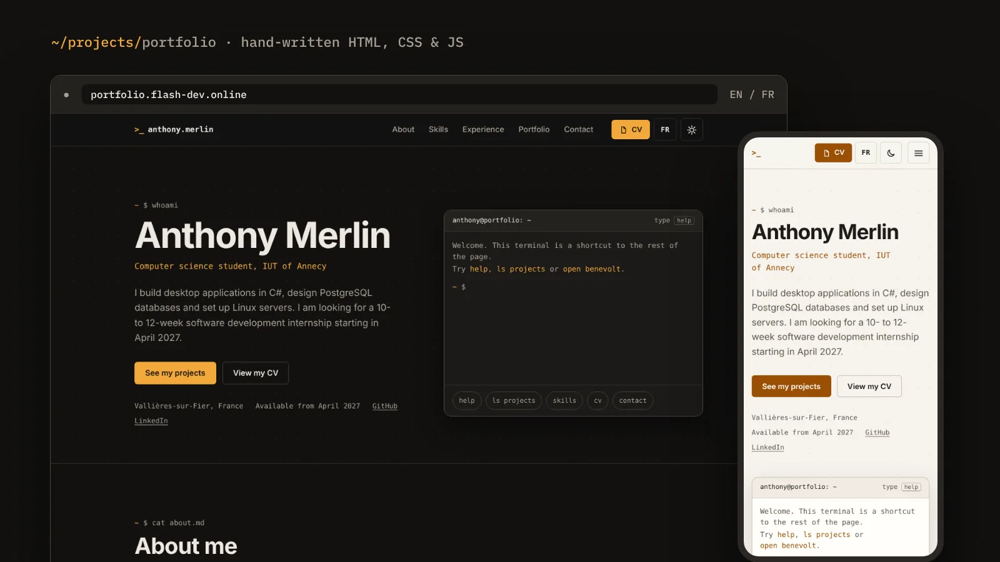

# Anthony Merlin · Portfolio

Portfolio et CV en ligne d'Anthony Merlin, étudiant en deuxième année de BUT Informatique à l'IUT d'Annecy.

**Site en ligne : [portfolio.flash-dev.online](https://portfolio.flash-dev.online/)**



## Le projet

Site d'une seule page écrit à la main en HTML, CSS et JavaScript, sans framework, sans CMS et sans back-end. Il est né d'un devoir de la ressource R3.12 (anglais professionnel) et sert aujourd'hui de portfolio principal pour les candidatures de stage.

La page présente le profil, les compétences, le parcours et la formation, puis un portfolio de projets universitaires et personnels. Chaque projet s'ouvre dans une fenêtre qui détaille le contexte, la part de travail personnelle, les technologies utilisées et les liens vers le code ou les comptes rendus.

## Fonctionnalités

- **Terminal interactif** en haut de page, avec des commandes (`help`, `ls projects`, `open benevolt`, `cv`, `contact`…), un historique et la complétion avec Tab
- **Filtres par technologie** et fenêtres de projets construites sur l'élément natif `<dialog>`
- **Visionneuse de CV** : choix de la version française ou anglaise, affichage du PDF, puis téléchargement
- **Français / anglais** : français par défaut, choix mémorisé d'une visite à l'autre
- **Thèmes clair et sombre**, calés sur le réglage du système tant qu'aucun thème n'a été choisi
- **Formulaire de contact** vérifié en JavaScript et envoyé via la messagerie du visiteur (aucun code serveur)
- **Accessibilité** : navigation au clavier, focus visible, libellés ARIA, animations réduites sur demande du système, contrastes vérifiés dans les deux thèmes
- **Mise en page responsive**, du mobile au grand écran

## Technologies

- HTML5, CSS3 (variables CSS, grid, `color-mix`), JavaScript natif (ES5, aucune dépendance)
- Polices IBM Plex Sans et IBM Plex Mono (Google Fonts)
- Hébergement sur GitHub Pages avec un nom de domaine personnalisé

## Fonctionnement

| Sujet | Mise en œuvre |
|---|---|
| Traduction | Le texte source est écrit en anglais dans `index.html`. `js/i18n-fr.js` associe chaque texte anglais à sa version française ; `main.js` parcourt les nœuds de texte de la page pour les remplacer, et rétablit le texte d'origine au retour vers l'anglais. |
| Fiches projets | Chaque fenêtre de projet est un `<template>` dans `index.html`, cloné dans un unique `<dialog>` à l'ouverture d'une tuile. Un lien comme `#project-benevolt` ouvre directement le projet. |
| Images manquantes | Tant qu'une capture n'est pas disponible, la tuile affiche une vignette avec le nom du projet au lieu d'une image cassée. |
| Cache | Les fichiers CSS, JavaScript, les images et les CV sont chargés avec un paramètre de version (`?v=…`), pour que les visiteurs réguliers reçoivent toujours la dernière version. |

## Structure

```
├── index.html          contenu de la page et fiches projets (<template>)
├── css/style.css       variables de design, thèmes clair/sombre, mise en page, responsive
├── js/main.js          terminal, filtres, fenêtres, thème, langue, formulaire de contact
├── js/i18n-fr.js       traductions françaises
├── cv/                 CV en anglais et en français (PDF)
├── docs/               comptes rendus de projets à télécharger (PDF)
└── img/                photo de profil et visuels des projets (WebP)
```

## Lancement en local

```bash
git clone https://github.com/flashlefilou/portfolio.git
cd portfolio
python3 -m http.server 8000
```

Le site est alors accessible sur http://localhost:8000.

## Contact

- E-mail : [anthomerlin74@gmail.com](mailto:anthomerlin74@gmail.com)
- LinkedIn : [anthony--merlin](https://www.linkedin.com/in/anthony--merlin/)
- GitHub : [flashlefilou](https://github.com/flashlefilou)
